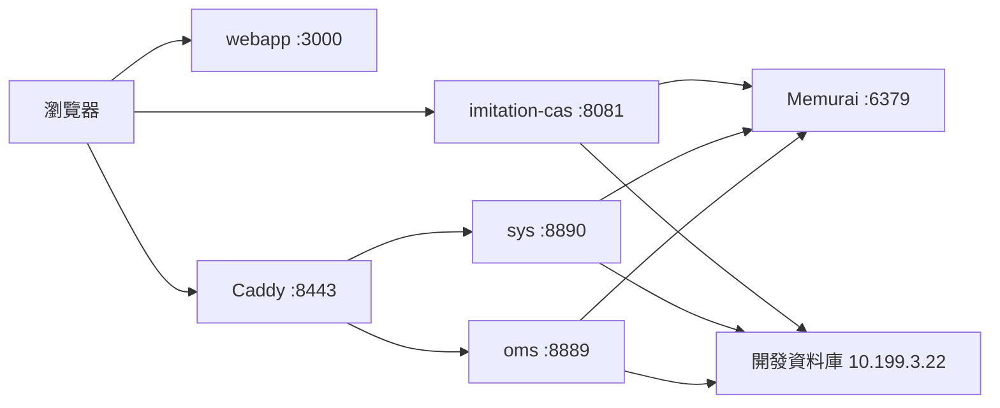
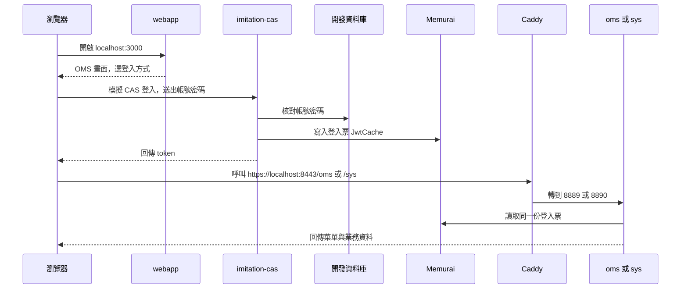

# 本機前端與啟動流程

`Start-ImitationDev.cmd` 拉起來的是 OMS 本機開發環境。瀏覽器請開 **http://localhost:3000**（這個開發伺服器只聽 http）。

## 3000 開的是什麼

`http://localhost:3000` 是 `D:\work\專案\webapp` 這個 React 前端的本機開發版。啟動參數是 `url=local` 和 `sysCode=oms`，所以進的是 OMS（訂單）那套畫面，頁面標題是「永聯物流開發」。

Rsbuild 負責把頁面送給瀏覽器。`url=local` 讓前端把 API 指到本機，而不是公司的開發站。

## 每個程式在做什麼

| 程式 | 你看到的位址 | 作用 |
|---|---|---|
| webapp | http://localhost:3000 | 畫面本身。Rsbuild 把 React 頁面送給瀏覽器 |
| imitation-cas | http://localhost:8081 | 假的登入服務，取代本機的 cas 和 klaw |
| Caddy | https://localhost:8443 | 依路徑轉送。`/oms` 轉到 oms，`/sys` 轉到 sys |
| oms | 實際埠 8889 | 訂單後端。瀏覽器不直接連 8889 |
| sys | 實際埠 8890 | 系統後端，選單、權限、部分共用 API |
| Memurai | localhost:6379 | 本機 Redis。登入票放在這裡，sys 和 oms 才認得出你 |

`cas` 和 `klaw` 不會被這個啟動檔打開，因為 imitation-cas 取代了它們。

## 登入之後發生什麼

帳號密碼跟開發環境同一組，比對的是開發資料庫 `10.199.3.22`。文件裡的測試帳是 `0989053831` / `000000`。這台電腦要能連到那台資料庫，所以需要公司內網或 VPN。

少開一個，畫面會卡在不同的地方：

- 沒有 **webapp**，3000 沒有頁面。
- 沒有 **imitation-cas**，按「模擬 CAS 登入」會連不上 8081。
- 沒有 **Memurai**，登入票沒地方放，後面的 API 會把你當成未登入。
- 沒有 **Caddy**，前端打 `https://localhost:8443` 沒有人接。
- 沒有 **sys** 或 **oms**，Caddy 會回 502，菜單或訂單資料出不來。

## 這次沒有啟動的系統

`sif`、`wes` 以及其他出現在 `webapp/src/config.url.js` 裡、但沒有在本機啟動的服務，前端仍會把網址組到 `https://localhost:8443/<服務>`。Caddy 沒有對應的轉送時會回 502。

部分靜態資源（例如 `publicImgUrl`）仍指向公司開發站，那些請求不會經過上面這台本機 Caddy。
